

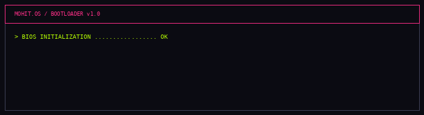

<samp>MOHIT.OS / PERSONAL DEVELOPER SYSTEM / ONLINE</samp>

---

## 00 / SYSTEM BOOT

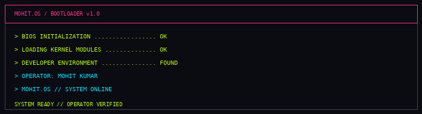

## 01 / OPERATOR IDENTITY

<samp>MOHIT KUMAR &nbsp; // &nbsp; @mohit31kumar &nbsp; // &nbsp; SOFTWARE DEVELOPER</samp>

## 02 / PROJECT UNIVERSE

<table width="100%">
<tr>
<td width="50%" align="center" valign="top">
<a href="https://github.com/mohit31kumar/ufosay">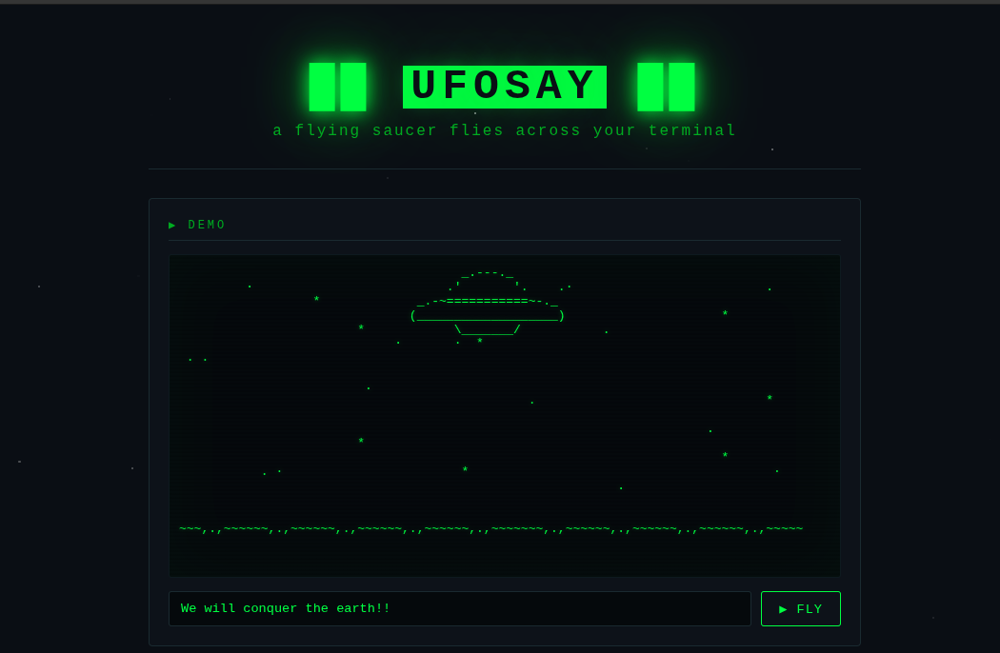</a>
<b>UFOSAY</b> PYTHON · <a href="https://ufosay.vercel.app">LIVE</a> · <a href="https://github.com/mohit31kumar/ufosay">REPO</a>
</td>
<td width="50%" align="center" valign="top">
<a href="https://github.com/mohit31kumar/face-unlock">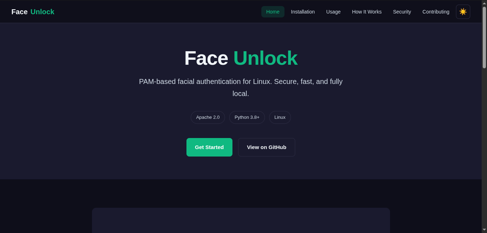</a>
<b>FACE-UNLOCK</b> PYTHON · <a href="https://mohit31kumar.github.io/face-unlock">LIVE</a> · <a href="https://github.com/mohit31kumar/face-unlock">REPO</a>
</td>
</tr>
<tr>
<td width="50%" align="center" valign="top">
<a href="https://github.com/mohit31kumar/ApnaDabba">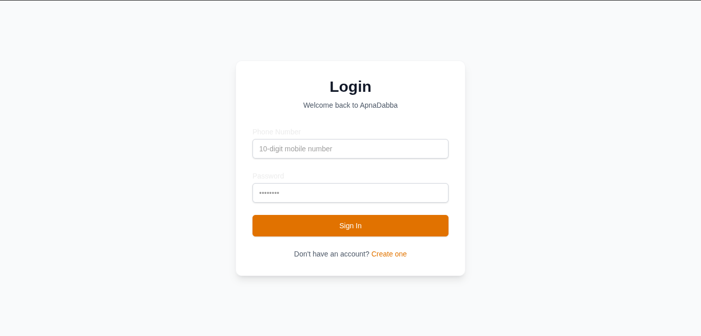</a>
<b>APNADABBA</b> TYPESCRIPT · <a href="https://apna-dabba-kappa.vercel.app">LIVE</a> · <a href="https://github.com/mohit31kumar/ApnaDabba">REPO</a>
</td>
<td width="50%" align="center" valign="top">
<a href="https://github.com/mohit31kumar/DB-MANAGER">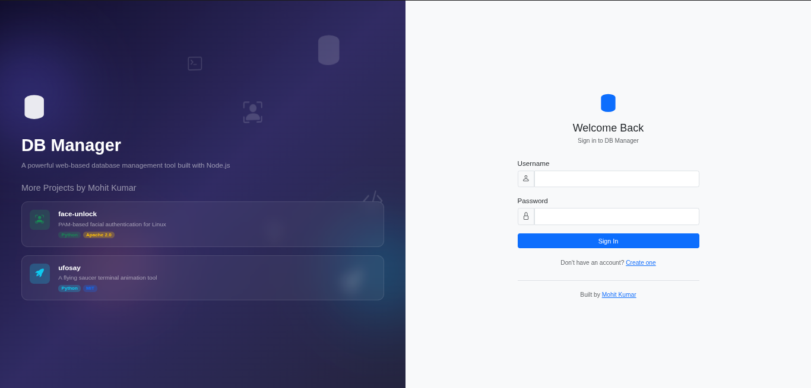</a>
<b>DB-MANAGER</b> EJS / JAVASCRIPT · <a href="https://db-manager-4n4m.onrender.com">LIVE</a> · <a href="https://github.com/mohit31kumar/DB-MANAGER">REPO</a>
</td>
</tr>
<tr>
<td width="50%" align="center" valign="top">
<a href="https://github.com/mohit31kumar/render">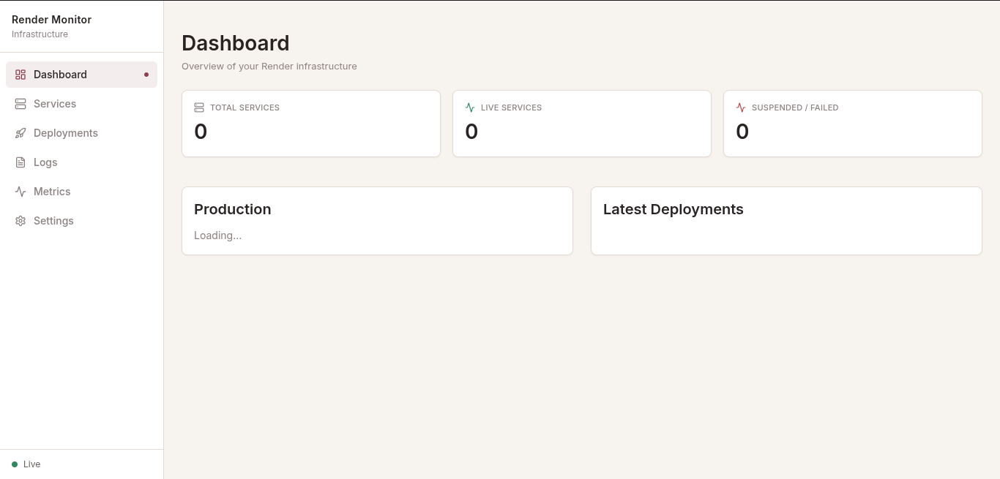</a>
<b>RENDER</b> TYPESCRIPT · <a href="https://render-web-4f5v.onrender.com">LIVE</a> · <a href="https://github.com/mohit31kumar/render">REPO</a>
</td>
<td width="50%" align="center" valign="top">
<a href="https://github.com/mohit31kumar/anti_theft">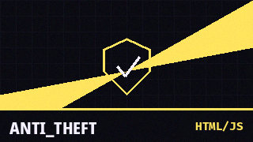</a>
<b>ANTI_THEFT</b> HTML · <a href="https://github.com/mohit31kumar/anti_theft">REPO</a>
</td>
</tr>
<tr>
<td colspan="2" align="center" valign="top">
<b>LIBRARY-MGMT</b> PYTHON · <a href="https://github.com/mohit31kumar/library-management">REPO</a> · EXISTING MAIN BRANCH HAS NO USABLE THUMBNAIL
</td>
</tr>
</table>

## 03 / TECH ARSENAL

**FRONTEND**
 

  
**BACKEND**
 

 REST APIs · JWT / SESSIONS

  
**DATA SYSTEMS**
 

 SEQUELIZE

  
**DEVELOPER WORKFLOW**
 

 RENDER

## 04 / THE LIVING MACHINE

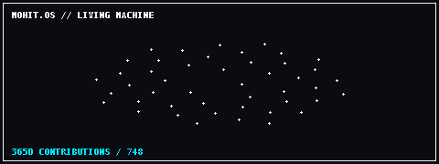
GITHUB CONTRIBUTION SIGNAL &nbsp; // &nbsp; NEURAL ACTIVITY FIELD

## 05 / SYSTEM TELEMETRY

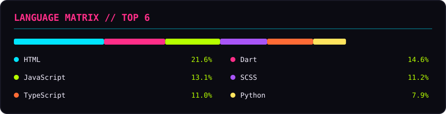
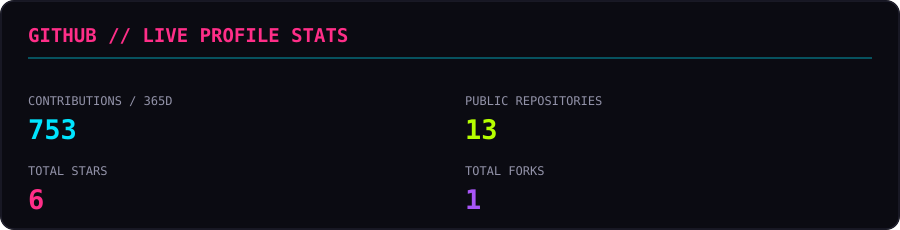

## 06 / CLASSIFIED ARCHIVE

<table width="100%">
<tr>
<td width="50%" align="center" valign="top">

<b>01 / UFOSAY</b> TERMINAL TOOL · <a href="https://github.com/mohit31kumar/ufosay">OPEN DOSSIER</a>
</td>
<td width="50%" align="center" valign="top">

<b>02 / FACE-UNLOCK</b> LINUX SECURITY · <a href="https://github.com/mohit31kumar/face-unlock">OPEN DOSSIER</a>
</td>
</tr>
<tr>
<td width="50%" align="center" valign="top">

<b>03 / DB-MANAGER</b> DATABASE TOOL · <a href="https://github.com/mohit31kumar/DB-MANAGER">OPEN DOSSIER</a>
</td>
<td width="50%" align="center" valign="top">

<b>04 / RENDER</b> RENDERING EXPERIMENTS · <a href="https://github.com/mohit31kumar/render">OPEN DOSSIER</a>
</td>
</tr>
</table>

<samp>ARCHIVE INDEX / APNADABBA · ANTI_THEFT · LIBRARY-MGMT</samp>
 
<a href="https://github.com/mohit31kumar?tab=repositories">BROWSE ALL REPOSITORIES</a>

## 07 / TROPHY CABINET

## 08 / COMMUNICATION LINK

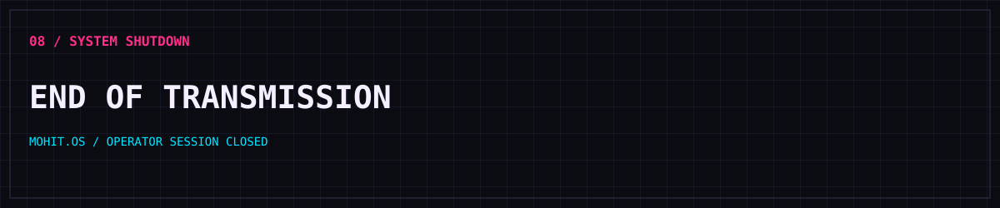

<samp>END OF TRANSMISSION // MOHIT.OS</samp>

