<!-- =====================================================================
     mohit31kumar // EXPERIMENTAL BRUTALISM x HACKER TERMINAL
     Visual system: void black canvas, chaotic neon accents, hard-edged
     panels, scanlines, glitch. All personal copy is a placeholder to
     approve/edit — see EDITABLE_CONTENT.md. Assets: see ASSET_MANIFEST.md.
     ===================================================================== -->

<!-- ============================ 01 // HERO TRANSMISSION ============================ -->
<a href="https://github.com/mohit31kumar">
  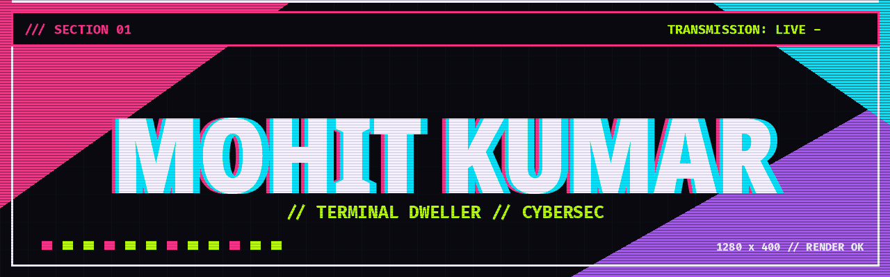
</a>

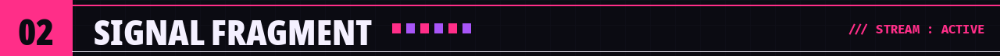

<!-- ============================ 02 // SIGNAL FRAGMENT ============================ -->
<blockquote>
  <samp>Building tools that live in the command line. Cybersecurity, systems, and the occasional flying saucer.</samp>
</blockquote>

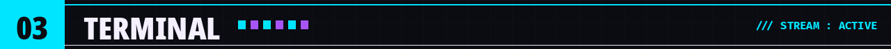

<!-- ============================ 03 // TERMINAL ============================ -->

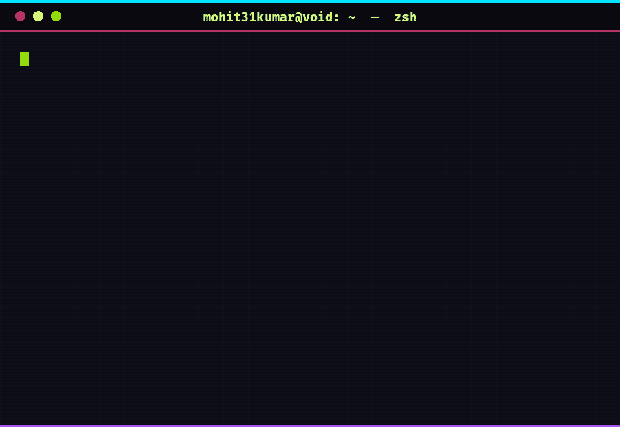

 

<!-- Real, clickable project links (the terminal above is a rendered image) -->

  
  
  
  
  
  
  

<samp>static render &nbsp;//&nbsp; links above are live</samp>

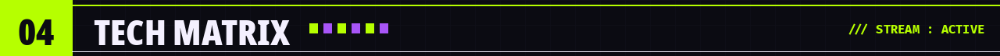

<!-- ============================ 04 // TECH MATRIX ============================ -->
<!-- NOTE: panels 02 (frameworks) and 03 (tools) are SUGGESTIONS — confirm before
     publishing. Languages/domains are verified from repo data. -->

<table align="center" width="100%">
<tr>
<td align="center" width="50%" valign="top">
  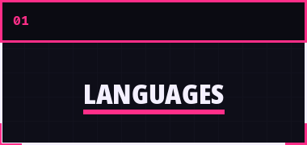
    
  
  
  
   
  
  
  
</td>
<td align="center" width="50%" valign="top">
  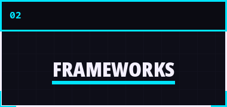
    
  
  
  
   
  
  
</td>
</tr>
<tr>
<td align="center" width="50%" valign="top">
  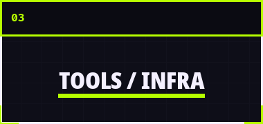
    
  
  
  
   
  
  
  
</td>
<td align="center" width="50%" valign="top">
  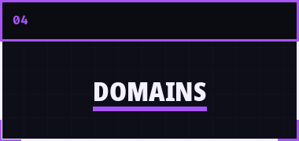
    
  
  
   
  
  
</td>
</tr>
</table>

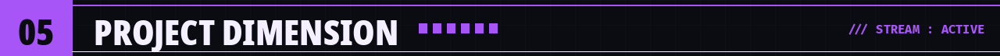

<!-- ============================ 05 // PROJECT DIMENSION ============================ -->
<!-- Descriptions marked [draft] are inferred from repo names — edit/confirm.
     Verify live links before publishing. -->

<table align="center" width="100%">
<tr>
<td align="center" width="50%" valign="top">
  <a href="https://github.com/mohit31kumar/ufosay">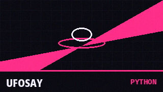</a>
   <b><samp>UFOSAY</samp></b> 
  A flying saucer terminal animation tool. 
  <a href="https://github.com/mohit31kumar/ufosay">REPO</a> · <a href="https://ufosay.vercel.app">LIVE</a>
</td>
<td align="center" width="50%" valign="top">
  <a href="https://github.com/mohit31kumar/face-unlock">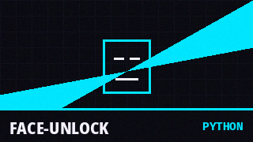</a>
   <b><samp>FACE-UNLOCK</samp></b> 
  PAM-based facial authentication for Linux. 
  <a href="https://github.com/mohit31kumar/face-unlock">REPO</a>
</td>
</tr>
<tr>
<td align="center" width="50%" valign="top">
  <a href="https://github.com/mohit31kumar/ApnaDabba">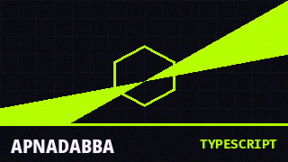</a>
   <b><samp>APNADABBA</samp></b> 
  Full-stack delivery application. 
  <a href="https://github.com/mohit31kumar/ApnaDabba">REPO</a> · <a href="https://apna-dabba-kappa.vercel.app">LIVE</a>
</td>
<td align="center" width="50%" valign="top">
  <a href="https://github.com/mohit31kumar/DB-MANAGER">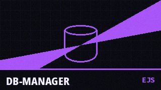</a>
   <b><samp>DB-MANAGER</samp></b> 
  Database management interface. 
  <a href="https://github.com/mohit31kumar/DB-MANAGER">REPO</a> · <a href="https://db-manager-4n4m.onrender.com">LIVE</a>
</td>
</tr>
<tr>
<td align="center" width="50%" valign="top">
  <a href="https://github.com/mohit31kumar/render">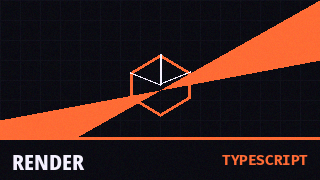</a>
   <b><samp>RENDER</samp></b> 
  Rendering engine experiments. 
  <a href="https://github.com/mohit31kumar/render">REPO</a>
</td>
<td align="center" width="50%" valign="top">
  <a href="https://github.com/mohit31kumar/anti_theft">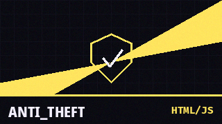</a>
   <b><samp>ANTI_THEFT</samp></b> 
  Anti-theft security tool. 
  <a href="https://github.com/mohit31kumar/anti_theft">REPO</a>
</td>
</tr>
<tr>
<td align="center" width="50%" valign="top">
  <a href="https://github.com/mohit31kumar/library-management">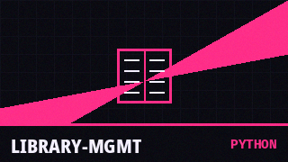</a>
   <b><samp>LIBRARY-MGMT</samp></b> 
  Library management system. 
  <a href="https://github.com/mohit31kumar/library-management">REPO</a>
</td>
<td align="center" width="50%" valign="top">
  
   <b><samp>ARG ?</samp></b> 
  Browse the full archive of repositories. 
  <a href="https://github.com/mohit31kumar?tab=repositories">ALL REPOS</a>
</td>
</tr>
</table>

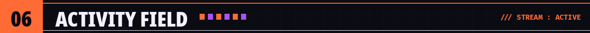

<!-- ============================ 06 // ACTIVITY FIELD ============================ -->

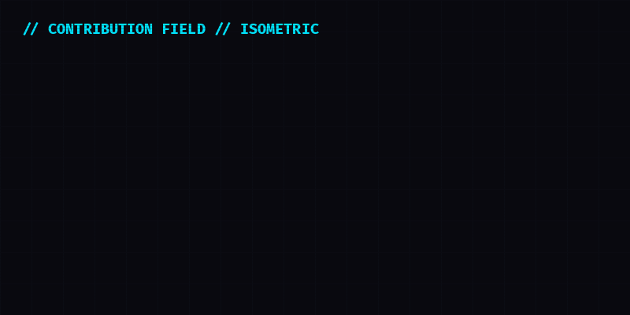

 
<samp>isometric field is decorative &nbsp;//&nbsp; live metrics below</samp>

  

 

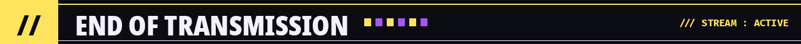

<!-- ============================ CLOSING // END OF TRANSMISSION ============================ -->

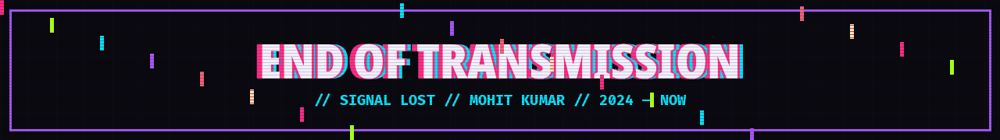

  

<!-- PLACEHOLDER SOCIALS — replace or remove before publishing. See EDITABLE_CONTENT.md -->

  

<samp>// signal lost // mohit31kumar // end of transmission</samp>

