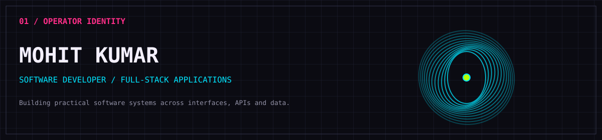
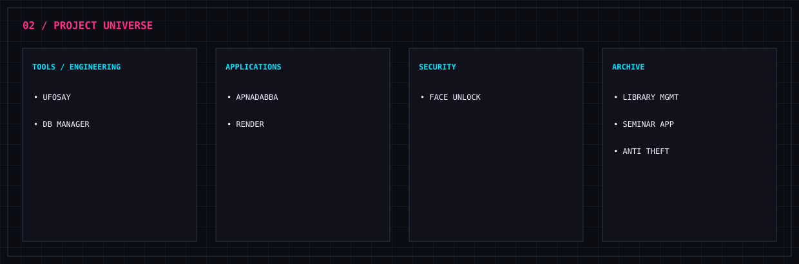
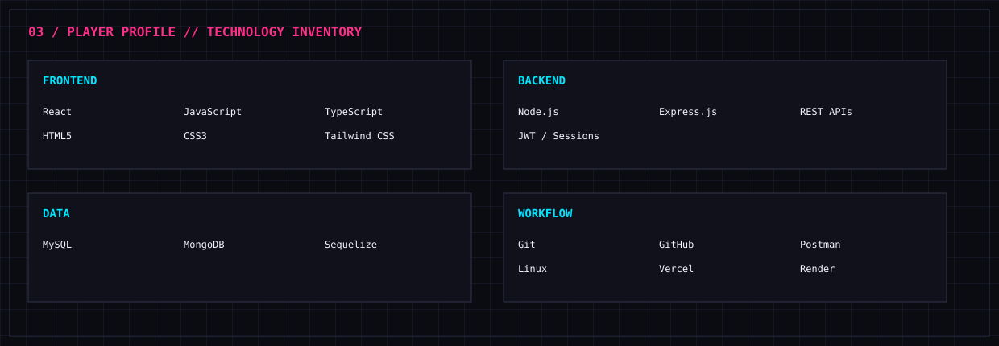
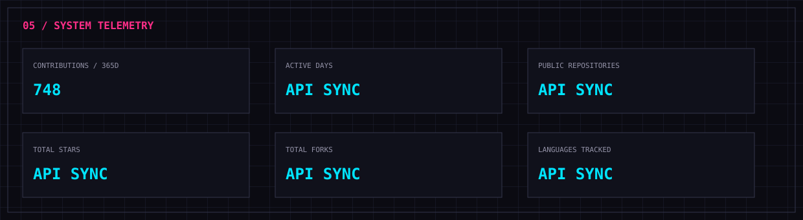
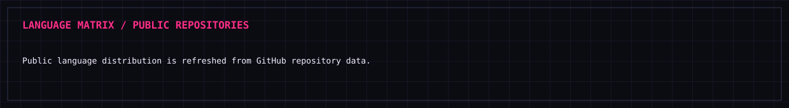
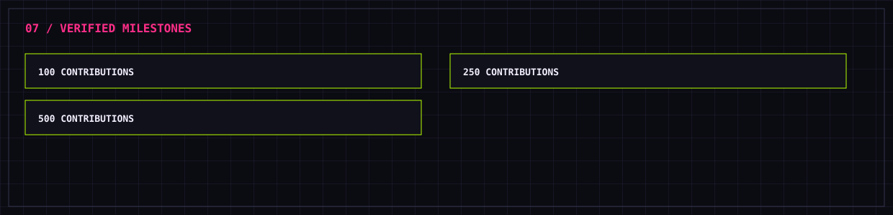

<samp>PERSONAL DEVELOPER OPERATING SYSTEM / BUILD 01.0</samp>

# MOHIT.OS

`// A digital workspace for software, systems and experiments //`

[GitHub Profile](https://github.com/mohit31kumar) · [All Repositories](https://github.com/mohit31kumar?tab=repositories)

---

## 00 / SYSTEM BOOT

BIOS INITIALIZED · KERNEL LOADED · OPERATOR IDENTIFIED

MOHIT.OS is the visual control room for my work: full-stack applications, developer tools, security experiments and software systems.

## 01 / OPERATOR IDENTITY

I'm **Mohit Kumar**, a software developer focused on building practical applications across frontend interfaces, backend APIs, databases and developer tooling.

OPERATOR HANDLE: @mohit31kumar · [GITHUB](https://github.com/mohit31kumar)

## 02 / WORLD ENGINE

A categorized map of public projects. Visual grouping is for navigation; it does not imply that separate projects share code or infrastructure.

### Featured project dossiers

| Project | Purpose | Stack | Access |
|---|---|---|---|
| **UFOSAY** | Flying saucer terminal animation tool | Python | [Repository](https://github.com/mohit31kumar/ufosay) · [Live](https://ufosay.vercel.app) |
| **FACE UNLOCK** | PAM-based facial authentication for Linux | Python | [Repository](https://github.com/mohit31kumar/face-unlock) · [Live](https://mohit31kumar.github.io/face-unlock) |
| **APNADABBA** | Full-stack tiffin delivery application | TypeScript | [Repository](https://github.com/mohit31kumar/ApnaDabba) · [Live](https://apna-dabba-kappa.vercel.app) |
| **DB MANAGER** | Database management interface | EJS / JavaScript | [Repository](https://github.com/mohit31kumar/DB-MANAGER) · [Live](https://db-manager-4n4m.onrender.com) |
| **RENDER** | Rendering engine experiments | TypeScript | [Repository](https://github.com/mohit31kumar/render) · [Live](https://render-web-4f5v.onrender.com) |

## 03 / PLAYER PROFILE

Technology inventory grouped by engineering area. No arbitrary skill percentages, XP or fabricated proficiency ranks.

- **Frontend:** React, JavaScript, TypeScript, HTML5, CSS3, Tailwind CSS
- **Backend:** Node.js, Express.js, REST APIs, JWT and session-based authentication
- **Data:** MySQL, MongoDB, Sequelize
- **Workflow:** Git, GitHub, Postman, Linux, Vercel and Render

## 04 / THE LIVING MACHINE

CONTRIBUTION SIGNAL → NEURAL ACTIVITY FIELD → VISUAL OUTPUT

The Living Machine translates the GitHub contribution calendar into a stylized 3D neural network. Node activation and signal intensity follow contribution levels; the network is a visual interpretation, not a diagram of GitHub's internal systems.

[View the static neural render](assets/living-machine/neural-network-static.png)

## 05 / SYSTEM TELEMETRY

Metrics are sourced from public GitHub profile and repository data. Contribution totals use the rolling calendar returned by GitHub; private activity is not inferred.

## 06 / CLASSIFIED ARCHIVE

- [Library Management](https://github.com/mohit31kumar/library-management)
- [Seminar App](https://github.com/mohit31kumar/seminar-app)
- [Anti Theft](https://github.com/mohit31kumar/anti_theft)

[Browse all public repositories](https://github.com/mohit31kumar?tab=repositories)

## 07 / ACHIEVEMENT SYSTEM

Milestones appear only when confirmed by collected GitHub contribution data. No invented ranks, XP, streaks or awards.

## 08 / SYSTEM SHUTDOWN

**[RECONNECT TO OPERATOR / GITHUB](https://github.com/mohit31kumar)**

<samp>END OF TRANSMISSION // MOHIT.OS</samp>

